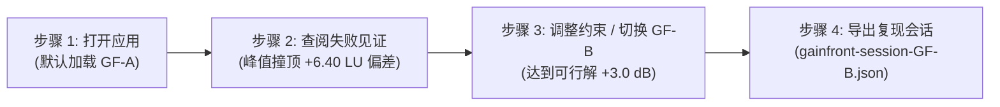

# 声限图 GainFront 用户使用指南 (User Guide)

GainFront 是一个面向声学与响度合规分析的纯本地浏览器声学工作台。无需安装后端服务、无需连接外部网络，所有计算（BS.1770-4 K-weighting 双门限滤波、4× 多相无理点 True-Peak 预估、481 点格点声限求解）均在浏览器 Dedicated Web Worker 中本地独立完成。

---

## 一、平台支持与运行环境声明

- **已测试验证平台**: Linux x86_64 (Ubuntu 24.04 LTS, Chromium 1.64.1)
- **Windows 平台声明**: **NOT_TESTED**（本项目目前未在实际 Windows 环境实测，严禁暗示已在 Windows 验证）
- **网络需求**: **完全离线可运行**（支持在断开外部网络的环境下完整运行，全程零外网请求）

---

## 二、2 分钟标准演示路径 (2-Minute Walkthrough)

以下为最快体验 GainFront 核心声学解释能力的推荐路径（全程约 2 分钟）：

### 步骤 1：打开应用首屏与默认预设

1. 在终端运行本地服务（如 `npm run preview` 或本地静态托管）并访问 `http://127.0.0.1:4173/`。
2. 页面载入后，Dedicated Worker 会自动对默认基准预设 **GF-A（峰值陷阱音频）** 执行全量声学计算。
3. 界面分为左侧**参数控制面板**与右侧**声学分析图表区**（波形对比、门限灯带、增益前沿图、见证报告、导入导出）。

### 步骤 2：GF-A 失败见证（恒定增益被真实峰值拦截）

1. 观察右侧下方 **「见证报告 (Witness Report)」** 插槽：
   - **求解状态**: 显示红色高亮标签 `GAIN_BLOCKED_PEAK_OR_RANGE`。
   - **状态解释**: `恒定增益被真实峰值拦截，无法在安全峰值上限内达成目标响度`。
   - **推荐最优增益 $g_{\text{best}}$**: `+0.6 dB`（受限停止于峰值边界）。
   - **理论目标增益 $g_{\text{target}}$**: `+7.0 dB`（欲达标所理论需增益）。
   - **响度偏差 (Deviation)**: `6.4005 LU`（大于允许容差 $\pm 0.25$ LU）。
   - **真实峰值安全边界**: `0.60 dB`。
2. 观察 **「波形对比插槽」**：
   - 绿色为原始波形，青色为施加 $+0.6\text{ dB}$ 后的波形。
   - 红色虚线竖标精确定位在第 4.0 秒（第 192,000 帧）的孤立突发采样点与 4× 插值微坐标（帧 192000，1/4点: 0，声道: 0）。
3. 观察 **「增益前沿图」**：
   - 481 点增益柱条中，大于 $+0.6\text{ dB}$ 的区域全部为红色（超上限），可行点为 0。

### 步骤 3：调整目标参数或切换至 GF-B（安全增益可达）

1. 在左侧面板的 **「目标集成响度 T」** 输入框中，输入 `-20.0` LUFS；或直接点击快捷预设按钮 **「GF-B (安全增益)」**。
2. 界面底部状态栏提示实时计算进度并瞬时完成：
   - **求解状态**: 变为青色标签 `GAIN_FEASIBLE`。
   - **推荐最优增益 $g_{\text{best}}$**: `+3.0 dB`。
   - **响度偏差**: `0.0036 LU`（严格落在 $\pm 0.25$ LU 容差范围内）。
   - **真实峰值**: `-13.67 dBTP`（严格低于有效上限 $-1.30$ dBTP）。
3. 观察增益前沿图：青色可行区间展开，紫线（理论目标）与青线（最优增益）完全重合。

### 步骤 4：导出审计会话 JSON

1. 滚动至底部 **「会话导入导出与重绑 (ImportExport)」** 区域。
2. 点击 **「导出当前会话 JSON (Export Session)」** 按钮。
3. 浏览器将提示保存 `gainfront-session-GF-B.json` 文件：
   - 导出会话符合 `gainfront.session/1` 格式规范。
   - 包含完整的声学约束参数、SHA-256 指纹与计算结论元数据。
   - **安全与隐私保障**: 导出的 JSON 文件仅包含数学约束与声学指标，绝对不包含任何原始音频波形字节。

---

## 三、免责声明与局限性 (Disclaimers & Limitations)

1. **4× 多相无理点插值近似说明**:
   - 本工具 True-Peak 计算采用符合 ITU-R BS.1770 标准的 48 阶 4× 多相 FIR 滤波器插值。
   - 针对高于 20 kHz 的极端高频能量叠加，该算法为工程最优近似估计，不承诺对所有极端合成信号具有绝对无限精度。
2. **安全裕量与合规免责**:
   - 系统内置硬编码默认安全裕量 $\text{margin} = 0.30\text{ dB}$，有效峰值门限计算公式为 $C_{\text{eff}} = C - 0.30\text{ dBTP}$。
   - 本工具提供的所有「可行」判定与增益推荐基于格点步长（0.1 dB）离散搜索，仅供声学工程调试参考，不构成广电或流媒体平台官方合规认证背书。
3. **音频数据隐私保证**:
   - GainFront 完全在本地客户端运行，WAV 音频解码与分析均在本地沙箱进行，不上传任何音频至云端或第三方服务器，不记录用户个人身份与音频内容。
